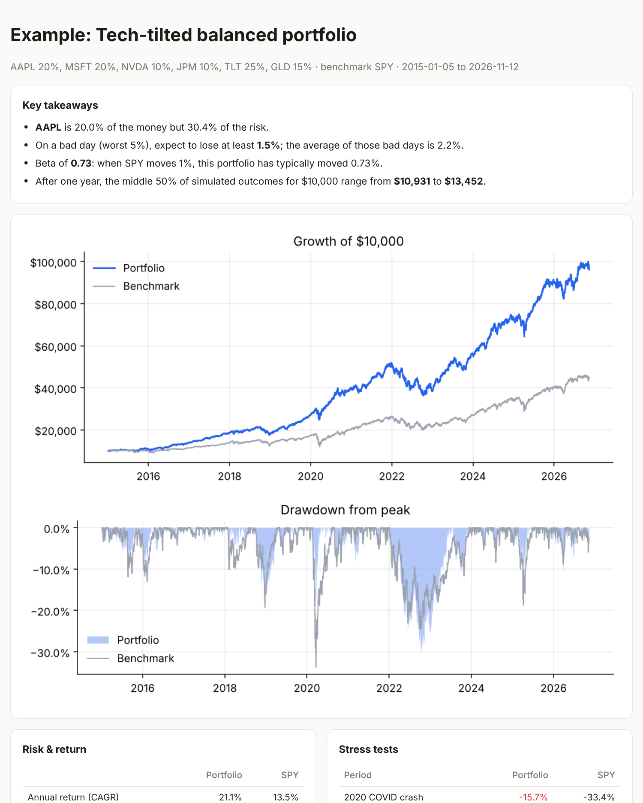

# portfolio-risk-report

Give it a list of holdings and it produces a clean, one-page HTML risk report. The report shows how the portfolio has performed, where its risk actually comes from, how it held up in past crashes, and the range of outcomes to expect over the next year.

**Live examples:** [Tech-tilted balanced portfolio](https://jshin0229.github.io/portfolio-risk-report/) · [Classic 60/40](https://jshin0229.github.io/portfolio-risk-report/60-40.html)

I was inspired by how student investment clubs like Algory Capital present portfolio analysis. I wanted a tool that turns a portfolio into a one-page report that someone without a finance background can read. The code is written from scratch.



## What's in a report

| Section | What it answers |
|---|---|
| **Key takeaways** | A plain-English summary written from the numbers |
| **Growth and drawdown** | How $10,000 would have grown, and how deep the losses got, compared with a benchmark |
| **Risk & return** | CAGR, volatility, Sharpe ratio, max drawdown, beta, 1-day VaR and CVaR at 95% |
| **Risk contribution** | Each holding's share of total portfolio variance, which is often very different from its weight |
| **Correlation heatmap** | Which holdings move together and which diversify |
| **Stress tests** | Portfolio vs benchmark in the 2008 crisis, the 2020 COVID crash and the 2022 rate hikes |
| **Monte Carlo** | 5,000 bootstrapped one-year paths for $10,000, with percentile bands |

## Run it

```bash
pip install -r requirements.txt
python -m riskreport AAPL:0.2 MSFT:0.2 NVDA:0.1 JPM:0.1 TLT:0.25 GLD:0.15 --out report.html
python -m riskreport VTI:0.6 BND:0.4 --start 2010-01-01 --benchmark SPY --title "My 60/40"
pytest
```

Weights don't need to add up to 1; they are normalized automatically. The output is a single HTML file with the charts embedded, so it can be emailed or hosted anywhere.

## How the numbers are calculated

- **Risk contribution** of holding *i* = *wᵢ (Σw)ᵢ / wᵀΣw*, where Σ is the annualized covariance matrix. The contributions add up to 100%.
- **VaR (95%)** is the 5th percentile of historical daily returns. **CVaR** is the average loss on days worse than the VaR.
- **Beta** is cov(portfolio, benchmark) / var(benchmark) on daily returns.
- **Monte Carlo** resamples actual historical daily returns (a bootstrap), so it keeps fat tails rather than assuming a normal distribution.
- The portfolio is assumed to be rebalanced to its target weights daily.

## Project layout

```
riskreport/analytics.py   Portfolio class: returns, stats, risk decomposition, stress tests, Monte Carlo
riskreport/report.py      Renders the HTML report and charts
riskreport/cli.py         Command line interface
tests/                    Unit tests (risk contributions sum to 1, benchmark beta = 1, CVaR ≥ VaR, …)
docs/                     Example reports served by GitHub Pages
```

*Educational project, not investment advice.*
